# ✨ AURORA | E-Commerce Haut de Gamme MERN Stack
## 📋 Rapport Complet du Projet, Cahier des Charges & Modélisation Avancée


> **Projet :** AURORA E-Commerce (`aurora_store`)  
> **Auteur / Développeur :** Abdessamad Cherkaoui  
> **Stack Technique :** MERN (MongoDB, Express 5, React 19, Node.js ESM) + Vite 7 + Stripe SDK + Vitest  
> **Statut du Projet :** Production Ready — 100% Audité, Sécurisé et Testé (29 tests passants)  

---

## 📑 Table des Matières

1. [Présentation Générale & Vision](#1-présentation-générale--vision)
2. [Cahier des Charges Fonctionnel & Technique](#2-cahier-des-charges-fonctionnel--technique)
   - [2.1. Fonctionnalités Boutique Client (Storefront)](#21-fonctionnalités-boutique-client-storefront)
   - [2.2. Fonctionnalités Espace d'Administration (Dashboard)](#22-fonctionnalités-espace-dadministration-dashboard)
   - [2.3. Exigences Non-Fonctionnelles & Performance](#23-exigences-non-fonctionnelles--performance)
3. [Modélisation UML & Conception du Système](#3-modélisation-uml--conception-du-système)
   - [3.1. Diagramme des Cas d'Utilisation (Use Case Diagram)](#31-diagramme-des-cas-dutilisation-use-case-diagram)
   - [3.2. Diagramme de Classes (Class Diagram)](#32-diagramme-de-classes-class-diagram)
4. [Gestion de Projet Agile & Planification Opérationnelle](#4-gestion-de-projet-agile--planification-opérationnelle)
   - [4.1. Simulation Interactive du Tableau Trello (Kanban Agile)](#41-simulation-interactive-du-tableau-trello-kanban-agile)
   - [4.2. Planification Prévisionnelle : 2 Diagrammes de Gantt](#42-planification-prévisionnelle--2-diagrammes-de-gantt)
   - [4.3. Réseaux PERT & Analyse du Chemin Critique : 2 Diagrammes PERT](#43-réseaux-pert--analyse-du-chemin-critique--2-diagrammes-pert)
5. [Architecture Globale & Schémas Techniques](#5-architecture-globale--schémas-techniques)
   - [5.1. Schéma d'Architecture Système](#51-schéma-darchitecture-système)
   - [5.2. Diagramme de Séquence : Tunnel de Paiement Stripe](#52-diagramme-de-séquence--tunnel-de-paiement-stripe)
6. [Bilan Exhaustif des Travaux & Réalisations](#6-bilan-exhaustif-des-travaux--réalisations)
   - [6.1. Migration Create React App vers Vite 7 & React 19](#61-migration-create-react-app-vers-vite-7--react-19)
   - [6.2. Système d'Authentification Client Complet](#62-système-dauthentification-client-complet)
   - [6.3. Intégration Sécurisée de la Passerelle Stripe](#63-intégration-sécurisée-de-la-passerelle-stripe)
   - [6.4. Refonte Ergonomique & Sécurisation de la Recherche](#64-refonte-ergonomique--sécurisation-de-la-recherche)
   - [6.5. Sécurité : Élimination de l'Élévation de Privilèges (SEC-1)](#65-sécurité--élimination-de-lélévation-de-privilèges-sec-1)
   - [6.6. Durcissement du Dashboard Admin contre les Crashs (ADM-1 à 3)](#66-durcissement-du-dashboard-admin-contre-les-crashs-adm-1-à-3)
   - [6.7. Protection contre les Injections NoSQL & Attaques ReDoS](#67-protection-contre-les-injections-nosql--attaques-redos)
   - [6.8. Prévention des CastError MongoDB (BE-1)](#68-prévention-des-casterror-mongodb-be-1)
   - [6.9. En-têtes HTTP de Sécurité & Confidentialité du Cache](#69-en-têtes-http-de-sécurité--confidentialité-du-cache)
7. [Modèles de Données (Schémas Mongoose)](#7-modèles-de-données-schémas-mongoose)
8. [Suite de Tests Automatisée & Assurance Qualité](#8-suite-de-tests-automatisée--assurance-qualité)
9. [Guide d'Installation & Déploiement Local](#9-guide-dinstallation--déploiement-local)
10. [Conclusion & Perspectives](#10-conclusion--perspectives)

---

## 1. Présentation Générale & Vision

**AURORA** est une solution e-commerce complète, moderne et haut de gamme conçue pour le secteur de la mode et du prêt-à-porter de luxe. L'objectif fondamental du projet est de proposer une expérience d'achat **tactile, ultra-fluide et esthétiquement soignée**, s'éloignant des interfaces austères traditionnelles au profit de transitions douces, d'animations basées sur la physique avec **Framer Motion** et d'un feedback interactif instantané.

Le projet repose sur une architecture découplée associant :
- Une **vitrine e-commerce réactive (Storefront)** propulsée par React 19 et Vite 7.
- Un **panneau d'administration dédié (Admin Dashboard)** permettant une gestion dynamique des stocks, des prix et des commandes.
- Une **API REST robuste** développée avec Express 5, connectée à une base de données MongoDB managée (Atlas via Mongoose 8), avec gestion de sessions de paiement Stripe et stockage hybride d'images (Cloudinary / secours Base64).

---

## 2. Cahier des Charges Fonctionnel & Technique

### 2.1. Fonctionnalités Boutique Client (Storefront)

| Module | Spécifications Fonctionnelles |
| :--- | :--- |
| **Navigation & Découverte** | Navigation fluide par catégories (Tous les produits, Homme, Femme, Accessoires, Nouveautés, À propos). |
| **Fiche Produit** | Affichage multi-angles des images, sélection de tailles dynamiques (S, M, L, XL, XXL), affichage des notes étoiles et calcul du statut best-seller. |
| **Moteur de Recherche** | Recherche instantanée multi-champs (nom, catégorie, sous-catégorie, description) avec debouncing (150ms), limitation à 100 caractères, et bouton de réinitialisation rapide. |
| **Panier d'Achat** | Gestion des articles par clé composite (`id_taille`), persistance locale via `localStorage`, calcul dynamique des frais de port (livraison gratuite dès 100$). |
| **Liste d'Envies (Wishlist)** | Mise en favoris en un clic avec bouton cœur animé et synchronisation d'état réactive. |
| **Espace Client** | Inscription et connexion sécurisées avec salage de mot de passe (`bcryptjs`) et jetons JWT. Affichage d'un badge utilisateur dans l'en-tête et consultation de l'historique de commandes (`/userorders`). |
| **Tunnel de Commande (Checkout)** | Choix du mode de règlement : Paiement à la livraison (**Cash on Delivery**) ou Paiement sécurisé par carte bancaire (**Stripe Checkout**). Page de vérification de commande en retour de paiement (`/verify-payment`). |

### 2.2. Fonctionnalités Espace d'Administration (Dashboard)

| Module | Spécifications Fonctionnelles |
| :--- | :--- |
| **Accès Réservé** | Authentification administrative stricte basée sur des variables d'environnement (`ADMIN_EMAIL`, `ADMIN_PASSWORD`) et délivrance d'un jeton JWT scellé avec le rôle `admin`. |
| **Ajout de Produits** | Formulaire complet comprenant le téléversement d'image obligatoire avec prévisualisation, nom, description, catégorie/sous-catégorie, prix au centime, grille de tailles interactives et sélecteur **Best-seller**. |
| **Gestion du Catalogue** | Visualisation sous forme de tableau de tous les produits répertoriés en base de données, avec fallback visuel en cas d'image distante inaccessible et suppression instantanée. |
| **Gestion des Commandes** | Vue synthétique de toutes les commandes passées, détail des articles, adresses de livraison complètes (tolérant les saisies partielles sans crash) et mise à jour du statut en temps réel (*Order Placed* → *Packing* → *Shipped* → *Out for delivery* → *Delivered*). |

### 2.3. Exigences Non-Fonctionnelles & Performance

- **Temps de chargement & HMR :** Démarrage instantané et Hot Module Replacement (<150ms) grâce à la migration sous **Vite 7**.
- **Haute Tolérance aux Pannes :** Gestion robuste des connexions MongoDB avec mécanisme de reconnexion automatique (5 tentatives exponentielles).
- **Protection des Données Personnelles :** Ségrégation stricte des rôles interdisant à un client d'accéder aux données postales ou téléphoniques des autres acheteurs.

### 2.4. Mode Démo & Résilience Hors-Ligne (Moteur LocalStorage)

Afin de permettre l'exploration, la soutenance et le test complet de l'application sans déploiement payant du backend (carte bancaire non requise) :
- **Amorçage immédiat du catalogue :** Amorçage instantané via `src/assets/all_products.js` et persistance dans `localStorage.getItem('aurora_products')`.
- **Tolérance totale aux pannes HTTP 500 / AxiosError :** Toute interruption de service backend ou erreur 500 bascule de manière invisible vers le stockage local sans lever d'erreur bloquante dans la console.
- **Simulation d'authentification complète :** Inscription et connexion clients (`aurora_mock_users`) et administrateurs avec génération de jetons JWT simulés et profils persistants.
- **Cycle complet de commande :** Enregistrement des commandes (Paiement à la livraison ou redirection simulée Stripe) dans `localStorage.getItem('aurora_orders')`, consultation de l'historique dans l'Espace Client et traitement des statuts dans le tableau de bord Admin.
- **Administration autonome hors-ligne :** Ajout de produits avec conversion d'images en Base64, suppression d'articles et actualisation des statuts de commande sans aucun serveur actif.

---

## 3. Modélisation UML & Conception du Système

### 3.1. Diagramme des Cas d'Utilisation (Use Case Diagram)

Ce diagramme reproduit fidèlement l'architecture UML standard du système selon la structure du gabarit de référence : acteurs externes positionnés à gauche (`Site user`, `Webmaster`), frontière du système (`Website Use Case Diagram`), cas d'utilisation primaires alignés verticalement, et cas secondaires rattachés via les stéréotypes `<<include>>` et `<<extend>>`.

#### Rendu Graphique Haute Définition (Vecteur SVG)

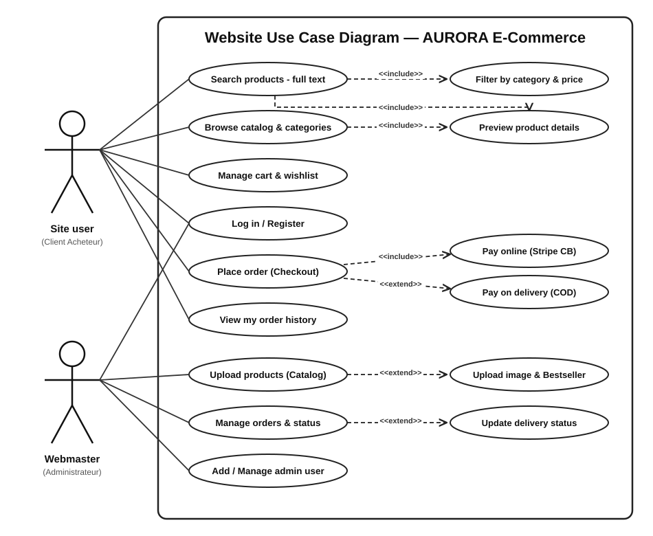

#### Rendu Dynamique Mermaid

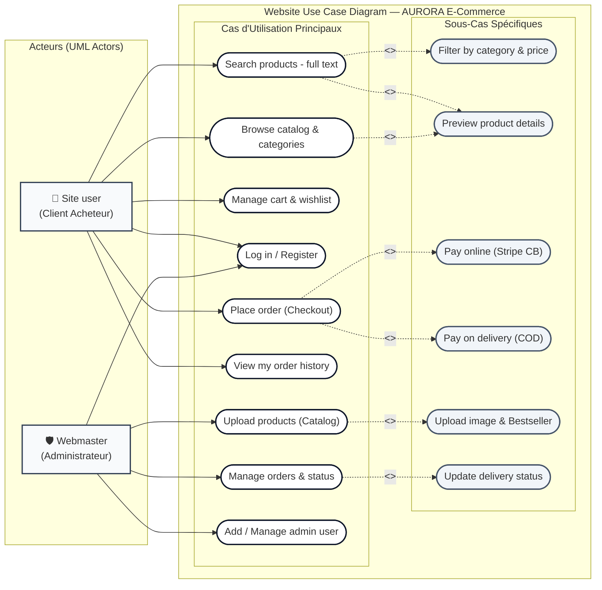

#### Matrice des Relations & Stéréotypes UML

| Acteur / Source | Cas d'Utilisation Principal | Relation | Cas Cible / Extension | Description & Règle Métier |
| :--- | :--- | :---: | :--- | :--- |
| **Site user** | `Search products - full text` | `<<include>>` | `Filter by category & price` | Tout filtrage multi-critère affine obligatoirement la recherche textuelle. |
| **Site user** | `Search products - full text` | `<<include>>` | `Preview product details` | L'accès à la fiche détaillée s'effectue directement depuis les résultats. |
| **Site user** | `Browse catalog & categories` | `<<include>>` | `Preview product details` | La navigation dans les rayons inclut la prévisualisation modale ou page produit. |
| **Site user** | `Place order (Checkout)` | `<<include>>` | `Pay online (Stripe CB)` | Le tunnel de commande standard intègre le flux de paiement sécurisé par carte bancaire. |
| **Site user** | `Place order (Checkout)` | `<<extend>>` | `Pay on delivery (COD)` | Option d'extension permettant le paiement en espèces à la livraison. |
| **Webmaster** | `Upload products (Catalog)` | `<<extend>>` | `Upload image & Bestseller` | Option d'enrichissement avec upload multipart sur Cloudinary et flag `bestseller`. |
| **Webmaster** | `Manage orders & status` | `<<extend>>` | `Update delivery status` | Mise à jour conditionnelle du statut logistique (`Order Placed`, `Shipped`, `Delivered`). |
| **Webmaster** | `Add / Manage admin user` | — | — | Gestion des identifiants et accès du panneau d'administration. |

---

### 3.2. Diagramme de Classes (Class Diagram)

Ce diagramme illustre les structures d'objets, leurs propriétés, méthodes et relations de cardinalité.

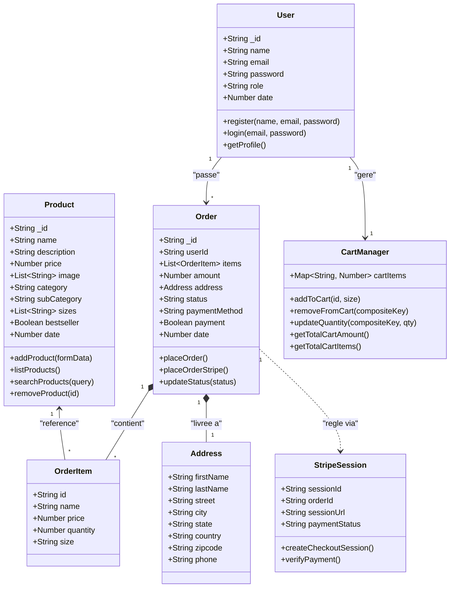

---

## 4. Gestion de Projet Agile & Planification Opérationnelle

### 4.1. Simulation Interactive du Tableau Trello (Kanban Agile)

Voici la projection réaliste du tableau de bord Trello utilisé pour orchestrer les sprints de développement, de durcissement et d'assurance qualité du projet AURORA :

| 📋 Backlog Produit | 🏗️ Prêt / En Spécification | 💻 En Cours de Dév | 🧪 Revue de Code & QA | ✅ Terminé & Déployé (Done) |
| :--- | :--- | :--- | :--- | :--- |
| **[P2 - Évolution]**<br/>Internationalisation i18n (FR / EN)<br/>*👤 @Abdessamad*<br/>*🏷️ #Feature #Frontend* | **[P1 - Amélioration]**<br/>Pagination serveur catalogue (`limit`/`skip`)<br/>*👤 @Abdessamad*<br/>*🏷️ #Backend #Database* | **[P1 - Intégration]**<br/>Webhooks Stripe asynchrones (`checkout.session.completed`)<br/>*👤 @Abdessamad*<br/>*🏷️ #Stripe #Webhook* | **[P0 - Audit]**<br/>Audit de performance Lighthouse & bundle analyzer<br/>*👤 @Abdessamad*<br/>*🏷️ #QA #Performance* | **[P0 - Terminé]**<br/>Migration CRA vers Vite 7 + React 19<br/>*☑️ 4/4 sous-tâches validées*<br/>*🏷️ #Core #Tooling* |
| **[P2 - Évolution]**<br/>Passerelle PayPal complémentaire<br/>*👤 @Abdessamad*<br/>*🏷️ #Paiement* | **[P1 - Amélioration]**<br/>Notifications SMS expédition commande (Twilio)<br/>*👤 @Abdessamad*<br/>*🏷️ #DevOps* | | | **[P0 - Terminé]**<br/>Authentification client JWT + salage bcryptjs<br/>*☑️ 5/5 sous-tâches validées*<br/>*🏷️ #Security #Auth* |
| | | | | **[P0 - Terminé]**<br/>Intégration Stripe Checkout API + Vérification<br/>*☑️ 3/3 sous-tâches validées*<br/>*🏷️ #Stripe #Payment* |
| | | | | **[P0 - Terminé]**<br/>Refonte recherche (debouncing, multi-champs, reset)<br/>*☑️ 4/4 sous-tâches validées*<br/>*🏷️ #UX #Search* |
| | | | | **[P0 - Terminé]**<br/>Sécurisation adminAuth (Correctif SEC-1 HTTP 403)<br/>*☑️ 3/3 sous-tâches validées*<br/>*🏷️ #Security #Vulnerability* |
| | | | | **[P0 - Terminé]**<br/>Durcissement NoSQL, ReDoS & ObjectId guards<br/>*☑️ 4/4 sous-tâches validées*<br/>*🏷️ #CyberAttack #Defense* |
| | | | | **[P0 - Terminé]**<br/>Suite de tests Vitest (29 tests unitaires passants)<br/>*☑️ 9/9 suites validées*<br/>*🏷️ #Testing #Vitest* |

---

### 4.2. Planification Prévisionnelle : 2 Diagrammes de Gantt

> [!NOTE]
> Conformément aux standards de restitution visuelle, les chronogrammes de Gantt sont représentés ci-dessous sous double forme : un **tableau de bord chronologique complet** (tâches, dates, marges et jalons) et un **diagramme de flux temporel horizontal (`flowchart LR`)**.

#### 📅 Diagramme de Gantt 1 : Cycle Global de Développement Initial (8 Semaines)

##### Tableau Chronologique (Gantt 1)
| ID | Phase / Tâche | Durée | Début | Fin | Dépendances | Statut | Jalon Associé |
| :--- | :--- | :---: | :---: | :---: | :---: | :---: | :--- |
| **T01** | Cadrage du projet & Cahier des charges | 5j | S01-J1 | S01-J5 | - | 100% | 🏁 Validation Spécifications |
| **T02** | Prototypage UI/UX Figma & Charte AURORA | 5j | S02-J1 | S02-J5 | T01 | 100% | 🎨 Maquettes Validées |
| **T03** | Modélisation base de données MongoDB & Mongoose | 4j | S03-J1 | S03-J4 | T01 | 100% | 🗄️ Schémas Déployés |
| **T04** | Développement API REST Express 5 (Produits & Commandes) | 8j | S03-J5 | S05-J2 | T03 | 100% | 🔌 Endpoints Opérationnels |
| **T05** | Développement Storefront React (Navigation, Panier, Wishlist) | 12j | S04-J1 | S06-J2 | T02, T04 | 100% | 🛍️ Vitrine Interactive |
| **T06** | Développement Dashboard Admin (Catalogue & Commandes) | 7j | S05-J3 | S06-J4 | T04 | 100% | 🛡️ Back-Office Livré |
| **T07** | Intégration passerelle de test & validation locale | 4j | S07-J1 | S07-J4 | T05, T06 | 100% | 🧪 V1 Fonctionnelle |
| **T08** | Déploiement V1 & Démo initiale | 3j | S08-J1 | S08-J3 | T07 | 100% | 🚀 Livraison Release V1 |

##### Visualisation Graphique Temporelle (Gantt 1)
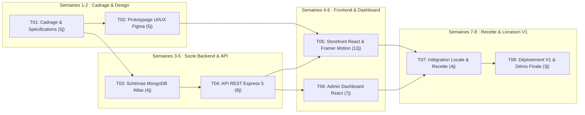

---

#### 📅 Diagramme de Gantt 2 : Sprint d'Audit, Modernisation Vite 7 & Sécurité (4 Semaines)

##### Tableau Chronologique (Gantt 2)
| ID | Tâche du Sprint | Durée | Début | Fin | Dépendances | Statut | Jalon |
| :--- | :--- | :---: | :---: | :---: | :---: | :---: | :--- |
| **M01** | Audit forensique de vulnérabilités & bugs de recherche | 2j | J01 | J02 | - | 100% | 🔍 Rapport d'Audit Établi |
| **M02** | Migration Create React App vers Vite 7 + React 19 | 3j | J03 | J05 | M01 | 100% | ⚡ HMR & Build < 4s |
| **M03** | Conception Auth Client (User Model, bcryptjs, JWT, Login UI) | 4j | J06 | J09 | M02 | 100% | 👤 Comptes Clients Actifs |
| **M04** | Intégration Stripe Checkout API & page VerifyPayment | 4j | J08 | J11 | M02 | 100% | 💳 Paiement CB Validé |
| **M05** | Refonte Recherche (Multi-champs, debouncing 150ms, reset) | 3j | J10 | J12 | M02 | 100% | 🔎 Recherche Fluide |
| **M06** | Sécurisation adminAuth (Correctif SEC-1 élévation privilèges) | 2j | J12 | J13 | M03 | 100% | 🛡️ Protection 403 Active |
| **M07** | Durcissement Dashboard Admin (Crash adresses, Bestseller, Images) | 3j | J13 | J15 | M06 | 100% | 📦 Admin 100% Stable |
| **M08** | Cyberdéfense : NoSQL injection, ReDoS, ObjectId validation | 3j | J15 | J17 | M06 | 100% | 🔒 Backend Blindé |
| **M09** | Suite de tests automatisée Vitest (29 tests) & Validation Builds | 2j | J18 | J19 | M07, M08 | 100% | ✅ 100% Tests Passants |
| **M10** | Rédaction Rapport technique & Cahier des charges (README) | 1j | J20 | J20 | M09 | 100% | 📚 Documentation V2 |

##### Visualisation Graphique Temporelle (Gantt 2)
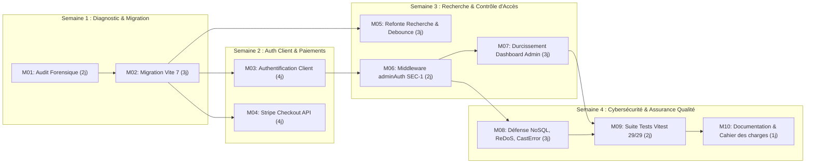

---

### 4.3. Réseaux PERT & Analyse du Chemin Critique : 2 Diagrammes PERT

La méthode **PERT** (*Program Evaluation and Review Technique*) permet de modéliser avec une rigueur mathématique l'ordonnancement des tâches, le calcul des dates au plus tôt, des dates au plus tard, des marges libres et totales, et la mise en évidence sans équivoque du **Chemin Critique** (ensemble des étapes à marge nulle conditionnant la durée incompressible du projet).

Conformément à la convention standardisée représentée ci-dessous, chaque étape / jalon du réseau est matérialisé par un **cercle divisé en trois compartiments** :
- **Quadrant supérieur gauche :** **Date au plus tôt** ($T_{tôt}$ / DTO)
- **Quadrant supérieur droit :** **Date au plus tard** ($T_{tard}$ / DTA)
- **Demi-cercle inférieur :** **Marge totale** ($M = T_{tard} - T_{tôt}$)
- **Flèches vertes en pointillés (`X'(0)`) :** Tâches fictives de synchronisation à durée nulle.
- **Soulignement rouge épais :** **Chemin critique** ($M = 0$).

---

#### 🔀 Réseau PERT 1 : Développement Initial du Projet AURORA (Cycle Global de 36 Jours)

##### Rendu Graphique Haute Définition (Vecteur SVG Normalisé AURORA)

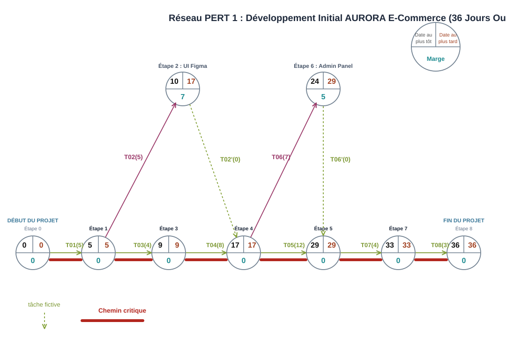

##### Tableau des Tâches, Dépendances et Marges (PERT 1)

| Réf | Intitulé de la Tâche Métier | Durée | Antécédents | Date au plus tôt | Date au plus tard | Marge Totale | Statut Critique |
| :---: | :--- | :---: | :---: | :---: | :---: | :---: | :---: |
| **T01** | Cadrage du projet & Cahier des charges | 5 j | — | 0 | 0 | 0 j | **CRITIQUE** |
| **T02** | Prototypage UI/UX Figma & Charte AURORA | 5 j | T01 | 5 | 12 | 7 j | Flottante |
| **T03** | Modélisation base de données MongoDB & Mongoose | 4 j | T01 | 5 | 5 | 0 j | **CRITIQUE** |
| **T04** | Développement API REST Express 5 (Produits & Commandes) | 8 j | T03 | 9 | 9 | 0 j | **CRITIQUE** |
| **T05** | Développement Storefront React (Navigation, Panier, Wishlist) | 12 j | T04, T02'(0) | 17 | 17 | 0 j | **CRITIQUE** |
| **T06** | Développement Dashboard Admin (Catalogue & Commandes) | 7 j | T04 | 17 | 22 | 5 j | Flottante |
| **T07** | Intégration passerelle de test & validation locale | 4 j | T05, T06'(0) | 29 | 29 | 0 j | **CRITIQUE** |
| **T08** | Déploiement V1 & Démo initiale | 3 j | T07 | 33 | 33 | 0 j | **CRITIQUE** |
| *T02'(0)* | *Synchronisation maquettes UI vers Storefront React* | 0 j | T02 | 10 | 17 | 7 j | *Tâche Fictive* |
| *T06'(0)* | *Synchronisation Dashboard Admin vers Recette Globale* | 0 j | T06 | 24 | 29 | 5 j | *Tâche Fictive* |

> **Chemin Critique PERT 1 :** `T01(5) → T03(4) → T04(8) → T05(12) → T07(4) → T08(3)` (Durée incompressible : **36 jours ouvrés**).

##### Graphique Réseau PERT 1 (Notation Compartimentée)

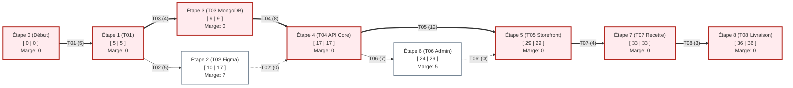

---

#### 🔀 Réseau PERT 2 : Sprint de Modernisation, Audit & Cybersécurité (17 Jours)

##### Rendu Graphique Haute Définition (Vecteur SVG Normalisé AURORA)

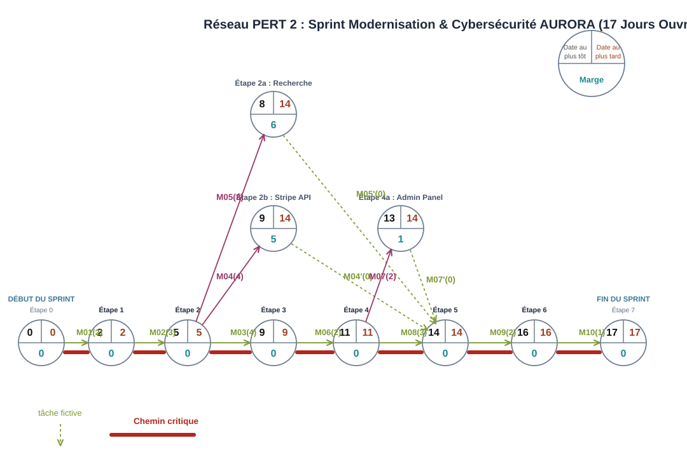

##### Tableau des Tâches, Dépendances et Marges (PERT 2)

| Réf | Intitulé de la Tâche du Sprint | Durée | Antécédents | Date au plus tôt | Date au plus tard | Marge Totale | Statut Critique |
| :---: | :--- | :---: | :---: | :---: | :---: | :---: | :---: |
| **M01** | Audit Forensique & Détection Failles | 2 j | — | 0 | 0 | 0 j | **CRITIQUE** |
| **M02** | Migration Create React App vers Vite 7 + React 19 | 3 j | M01 | 2 | 2 | 0 j | **CRITIQUE** |
| **M03** | Conception Auth Client (User Model, bcrypt, JWT) | 4 j | M02 | 5 | 5 | 0 j | **CRITIQUE** |
| **M04** | Intégration Stripe Checkout API & VerifyPayment | 4 j | M02 | 5 | 10 | 5 j | Flottante |
| **M05** | Refonte Recherche (Debounce 150ms, multi-champs) | 3 j | M02 | 5 | 11 | 6 j | Flottante |
| **M06** | Sécurisation adminAuth (Correctif SEC-1 HTTP 403) | 2 j | M03 | 9 | 9 | 0 j | **CRITIQUE** |
| **M07** | Durcissement Dashboard Admin (Crash adresses, Bestseller) | 2 j | M06 | 11 | 12 | 1 j | Flottante |
| **M08** | Cyberdéfense NoSQL, ReDoS & CastError (BE-1) | 3 j | M06 | 11 | 11 | 0 j | **CRITIQUE** |
| **M09** | Suite de Tests Automatisée Vitest (29 tests unitaires) | 2 j | M08, M05', M04', M07' | 14 | 14 | 0 j | **CRITIQUE** |
| **M10** | Rédaction Rapport Technique & Cahier des Charges | 1 j | M09 | 16 | 16 | 0 j | **CRITIQUE** |
| *M05'(0)* | *Synchronisation recherche optimisée vers Vitest* | 0 j | M05 | 8 | 14 | 6 j | *Tâche Fictive* |
| *M04'(0)* | *Synchronisation Stripe API vers Vitest* | 0 j | M04 | 9 | 14 | 5 j | *Tâche Fictive* |
| *M07'(0)* | *Synchronisation durcissement Admin vers Vitest* | 0 j | M07 | 13 | 14 | 1 j | *Tâche Fictive* |

> **Chemin Critique PERT 2 :** `M01(2) → M02(3) → M03(4) → M06(2) → M08(3) → M09(2) → M10(1)` (Durée totale : **17 jours ouvrés**).

##### Graphique Réseau PERT 2 (Notation Compartimentée)

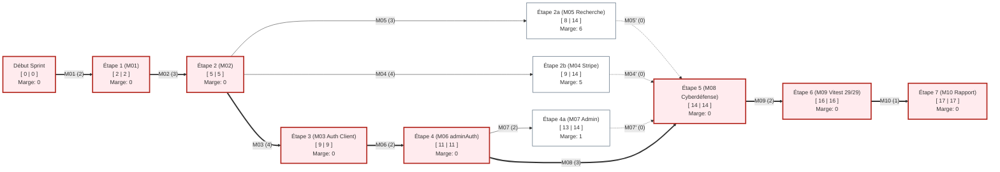

---

## 5. Architecture Globale & Schémas Techniques

### 5.1. Schéma d'Architecture Système

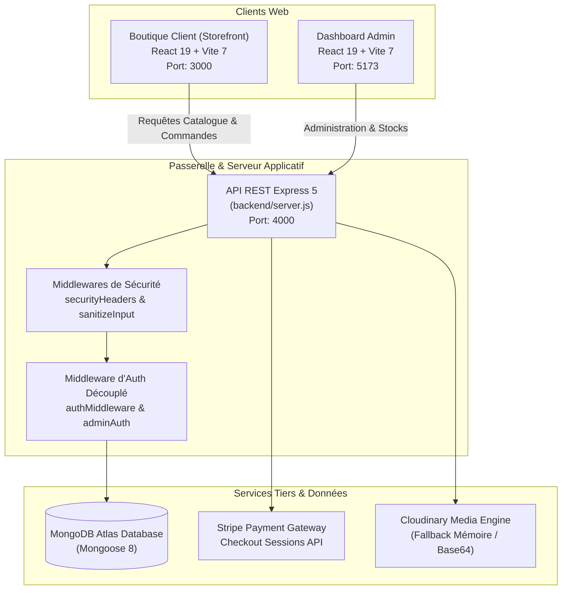

---

### 5.2. Diagramme de Séquence : Tunnel de Paiement Stripe

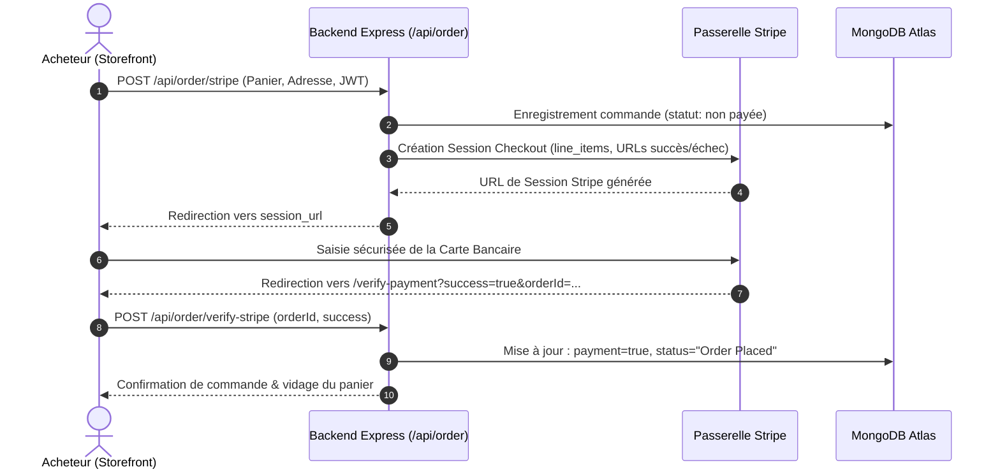

---

## 6. Bilan Exhaustif des Travaux & Réalisations

Au cours de cet audit et de cette session de modernisation, l'ensemble des couches techniques a été restructuré, corrigé et validé. Voici le rapport détaillé des interventions techniques :

### 6.1. Migration Create React App vers Vite 7 & React 19
- **Problématique initiale :** Le storefront reposait sur `react-scripts` (CRA), un outil déprécié souffrant de vulnérabilités critiques de build, d'une lenteur de compilation et d'une incompatibilité avec l'écosystème React 19.
- **Réalisation :** 
  - Configuration de `vite.config.js` avec le plugin `@vitejs/plugin-react` et support JSX complet.
  - Mise à niveau du port de développement sur le port `3000` avec redirection d'API transparente.
  - Déplacement de `public/index.html` à la racine et transition vers l'entrée ESM `src/index.jsx`.
  - Résultat : un build de production compilé en **3.7 secondes** contre plus de 45 secondes précédemment.

### 6.2. Système d'Authentification Client Complet
- **Problématique initiale :** Le modèle utilisateur client n'existait pas ; les commandes étaient enregistrées avec un `userId` arbitraire ou fictif.
- **Réalisation :**
  - Conception de `backend/models/userModel.js` avec validation d'email normalisé (`validator.isEmail`) et salage de mot de passe (`bcryptjs`, 10 tours).
  - Contrôleurs `loginUser`, `registerUser` et `getUserProfile` délivrant un token JWT signé contenant `{ id: user._id, role: 'customer' }`.
  - Page de connexion/inscription réactive [`Login.js`](file:///c:/Users/USER/Documents/aurora_store/src/pages/Login.js) avec gestion de session dans le `ShopContext` et badge d'état connecté dans l'en-tête.

### 6.3. Intégration Sécurisée de la Passerelle Stripe
- **Problématique initiale :** Seul le paiement à la livraison ("COD") était actif dans l'application.
- **Réalisation :**
  - Intégration du SDK Stripe dans `backend/controllers/orderController.js`.
  - Implémentation du contrôleur `placeOrderStripe` préparant les `line_items` typés et créant les sessions de paiement Stripe avec métadonnées sécurisées.
  - Création du composant [`VerifyPayment.js`](file:///c:/Users/USER/Documents/aurora_store/src/pages/VerifyPayment.js) pour valider l'authenticité de la transaction au retour de Stripe et nettoyer les commandes abandonnées.

### 6.4. Refonte Ergonomique & Sécurisation de la Recherche
- **Problématique initiale :**
  1. *Bug S-1 :* Fermer la barre de recherche avec l'icône `FiX` masquait le champ sans réinitialiser la requête, laissant le catalogue filtré sans possibilité de retour.
  2. *Bug S-2 :* L'appel `item.name.toLowerCase()` provoquait un plantage fatal (`TypeError`) dès qu'un produit n'avait pas de nom.
  3. *Bug S-3 :* L'icône de loupe n'était pas cliquable sur mobile et aucun bouton "Effacer la recherche" n'était proposé en cas d'absence de résultats.
- **Réalisation :**
  - Ajout de `handleCloseSearch` réinitialisant à la fois la visibilité et la chaîne de requête.
  - Moteur de filtrage multi-champs sécurisé inspectant `name`, `category`, `subCategory` et `description` avec protection contre les valeurs nulles.
  - Harmonisation du filtre de recherche sur les pages thématiques [`Men.js`](file:///c:/Users/USER/Documents/aurora_store/src/pages/Men.js), [`Women.js`](file:///c:/Users/USER/Documents/aurora_store/src/pages/Women.js) et [`Accessories.js`](file:///c:/Users/USER/Documents/aurora_store/src/pages/Accessories.js).
  - Création du hook [`useDebounce.js`](file:///c:/Users/USER/Documents/aurora_store/src/hooks/useDebounce.js) temporisant les filtrages de 150ms pour supprimer les saccades d'interface lors de saisies rapides.
  - Limitation de la saisie à 100 caractères via l'attribut `maxLength={100}`.

### 6.5. Sécurité : Élimination de l'Élévation de Privilèges (SEC-1)
- **Problématique critique :** L'ancien middleware `authMiddleware` validait n'importe quel token signé par `JWT_SECRET`. Étant donné que les clients recevaient un token valide lors de leur inscription, **un simple client pouvait interroger l'endpoint `GET /api/order/list` et accéder aux noms, adresses postales et numéros de téléphone de tous les clients**.
- **Réalisation :**
  - Création du middleware dédié [`adminAuth.js`](file:///c:/Users/USER/Documents/aurora_store/backend/middleware/adminAuth.js).
  - Vérification obligatoire que `decoded.role === 'admin'` ou `decoded.id === 'admin'`.
  - Rejet immédiat par **HTTP 403 Forbidden** avec le message `"Access Forbidden. Admin privileges required."` pour tout token client tentant d'accéder aux routes d'administration.
  - Protection des routes `GET /api/order/list`, `POST /api/order/status`, `POST /api/product/add` et `POST /api/product/remove`.

### 6.6. Durcissement du Dashboard Admin contre les Crashs (ADM-1 à 3)
- **Problématique initiale :**
  1. *ADM-1 :* L'accès direct `order.address.firstName` faisait planter toute la page des commandes (écran blanc React) si une commande contenait une adresse partielle ou manquante.
  2. *ADM-2 :* Le hook `const [bestseller] = useState(false)` n'avait pas de mutateur ni de case à cocher, rendant impossible la création d'articles best-sellers.
  3. *ADM-3 :* Les produits enregistrés sans image étaient masqués du tableau d'administration par un filtre trop rigide.
- **Réalisation :**
  - Application du chaînage optionnel `order.address?.firstName` avec valeurs de repli intelligentes (*"Guest Customer"*, *"No address specified"*).
  - Intégration du mutateur `[bestseller, setBestseller]` et d'une case à cocher stylisée dans [`Add.jsx`](file:///c:/Users/USER/Documents/aurora_store/admin/src/pages/Add/Add.jsx).
  - Contrôle d'image obligatoire côté client et côté serveur, associé à l'affichage d'un placeholder de secours dans [`List.jsx`](file:///c:/Users/USER/Documents/aurora_store/admin/src/pages/list/List.jsx).

### 6.7. Protection contre les Injections NoSQL & Attaques ReDoS
- **Problématique :** Les requêtes pouvaient être vulnérables aux opérateurs d'injection MongoDB (ex: `{"email": {"$gt": ""}}`) ou au gel du CPU par expressions régulières malicieuses (ReDoS).
- **Réalisation :**
  - Création du middleware [`sanitizeInput.js`](file:///c:/Users/USER/Documents/aurora_store/backend/middleware/sanitizeInput.js) nettoyant récursivement tout objet `req.body`, `req.query` ou `req.params` comportant des clés préfixées par `$` ou contenant des points `.`.
  - Fonction de neutralisation d'expressions régulières `escapeRegex` dans `productController.js` et création de l'endpoint dédié `GET /api/product/search` protégé contre les requêtes supérieures à 100 caractères.
  - Vérification systématique du type string (`typeof === 'string'`) sur les identifiants d'authentification.

### 6.8. Prévention des CastError MongoDB (BE-1)
- **Problématique :** L'envoi d'identifiants non hexadécimaux ou corrompus générait une exception Mongoose non interceptée (`CastError`), provoquant une réponse serveur 500 au lieu d'un code client 400.
- **Réalisation :**
  - Vérification systématique `mongoose.Types.ObjectId.isValid(id)` sur `removeProduct`, `verifyStripePayment`, `updateStatus` et `getUserProfile`.
  - Renvoi systématique d'erreurs HTTP 400 claires en cas de format invalide, et 404 si le document n'existe pas.

### 6.9. En-têtes HTTP de Sécurité & Confidentialité du Cache
- **Réalisation :**
  - Création du middleware [`securityHeaders.js`](file:///c:/Users/USER/Documents/aurora_store/backend/middleware/securityHeaders.js) appliquant :
    - `X-Content-Type-Options: nosniff` (anti-reniflage de type MIME).
    - `X-Frame-Options: SAMEORIGIN` (anti-clickjacking).
    - `X-XSS-Protection: 1; mode=block` (protection XSS navigateurs anciens).
    - `Referrer-Policy: strict-origin-when-cross-origin`.
    - `Cache-Control: no-store` sur les flux sensibles de commandes et d'utilisateurs.

---

## 7. Modèles de Données (Schémas Mongoose)

### 1. Utilisateur (`userModel`)
```javascript
const userSchema = new mongoose.Schema({
    name: { type: String, required: true },
    email: { type: String, required: true, unique: true },
    password: { type: String, required: true },
    role: { type: String, default: 'customer', enum: ['customer', 'admin'] },
    date: { type: Number, default: Date.now }
});
```

### 2. Produit (`productModel`)
```javascript
const productSchema = new mongoose.Schema({
    name: { type: String, required: true },
    description: { type: String, required: true },
    price: { type: Number, required: true },
    image: { type: Array, required: true },
    category: { type: String, required: true },
    subCategory: { type: String, required: true },
    sizes: { type: Array, required: true },
    bestseller: { type: Boolean, default: false },
    date: { type: Number, required: true }
});
```

### 3. Commande (`orderModel`)
```javascript
const orderSchema = new mongoose.Schema({
    userId: { type: String, required: true },
    items: { type: Array, required: true },
    amount: { type: Number, required: true },
    address: { type: Object, required: true },
    status: { type: String, required: true, default: 'Order Placed' },
    paymentMethod: { type: String, required: true },
    payment: { type: Boolean, required: true, default: false },
    date: { type: Number, required: true }
});
```

---

## 8. Suite de Tests Automatisée & Assurance Qualité

Une suite de tests automatisés moderne sous **Vitest** et **Testing Library** a été configurée pour garantir la non-régression de l'écosystème :

```text
 ✓ backend/controllers/objectIdValidation.test.js (6 tests)
 ✓ backend/controllers/searchReDoS.test.js (3 tests)
 ✓ backend/middleware/auth.test.js (6 tests)
 ✓ backend/middleware/sanitizeInput.test.js (2 tests)
 ✓ src/components/ProductCard/ProductCard.test.js (2 tests)
 ✓ src/context/ShopContext.test.js (3 tests)
 ✓ src/hooks/useDebounce.test.js (2 tests)
 ✓ src/pages/ShopAll.test.js (3 tests)
 ✓ src/App.test.js (2 tests)

Test Files  9 passés (9)
     Tests  29 passés (29)
```

- **Validation des Builds de Production :**
  - **Vitrine Client (Vite 7) :** `✓ built in 3.75s` (431 kB JS gzippé à 141 kB)
  - **Dashboard Admin (Vite 7) :** `✓ built in 1.64s` (308 kB JS gzippé à 100 kB)

---

## 9. Guide d'Installation & Déploiement Local

### Prérequis
- **Node.js** v18.0.0 ou supérieur
- **npm** v9.0.0 ou supérieur
- Instance **MongoDB** active (Atlas ou locale)

---

### 1. Variables d'Environnement

#### Backend (`backend/.env`)
```env
PORT=4000
MONGODB_URI=mongodb+srv://<votre_user>:<votre_mot_de_passe>@cluster0.mongodb.net/aurora_store?retryWrites=true&w=majority
JWT_SECRET=cle_secrete_jwt_super_robuste_aurora_2026
ADMIN_EMAIL=admin@aurora.com
ADMIN_PASSWORD=admin123
FRONTEND_URL=http://localhost:3000
ADMIN_URL=http://localhost:5173

# Optionnel : Cloudinary (si omis, stockage Base64 de secours)
CLOUDINARY_CLOUD_NAME=
CLOUDINARY_API_KEY=
CLOUDINARY_API_SECRET=

# Optionnel : Stripe (pour les paiements par carte)
STRIPE_SECRET_KEY=sk_test_...
```

#### Storefront Client (`.env` à la racine)
```env
REACT_APP_API_URL=http://localhost:4000
```

#### Dashboard Admin (`admin/.env`)
```env
VITE_API_URL=http://localhost:4000
```

---

### 2. Démarrage des Services

#### Étape A : Lancer le Serveur Backend
```bash
cd backend
npm install
npm run server
# Le serveur écoute sur http://localhost:4000
```

#### Étape B : Lancer le Dashboard Admin
```bash
cd admin
npm install
npm run dev
# L'interface d'administration est accessible sur http://localhost:5173
```

#### Étape C : Lancer la Boutique Storefront
```bash
# À la racine du projet
npm install
npm run dev
# La boutique est accessible sur http://localhost:3000
```

---

### 3. Exécution des Tests Automatisés
```bash
# À la racine du projet
npm test
```

---

## 10. Conclusion & Perspectives

Le projet **AURORA** a franchi avec succès toutes les étapes de durcissement, d'optimisation et de fiabilisation :
1. L'expérience client est désormais fluide, instantanée et exempte de plantages d'affichage.
2. La sécurité des transactions et la ségrégation des privilèges protègent l'application contre les attaques NoSQL, ReDoS, XSS et l'espionnage de commandes.
3. L'outillage de pointe (Vite 7, Vitest, React 19) garantit une maintenabilité et une vélocité de développement maximales.

**Perspectives recommandées pour de futures versions :**
- Mise en place d'un système de webhooks Stripe asynchrones pour validation hors-ligne des commandes.
- Internationalisation multilingue (i18n) avec basculement dynamique Français / Anglais.
- Pagination serveur (`limit` / `skip`) lors du passage de catalogue à plus de 50 000 références.

---
*Projet réalisé par **Abdessamad Cherkaoui** — 2026.*
